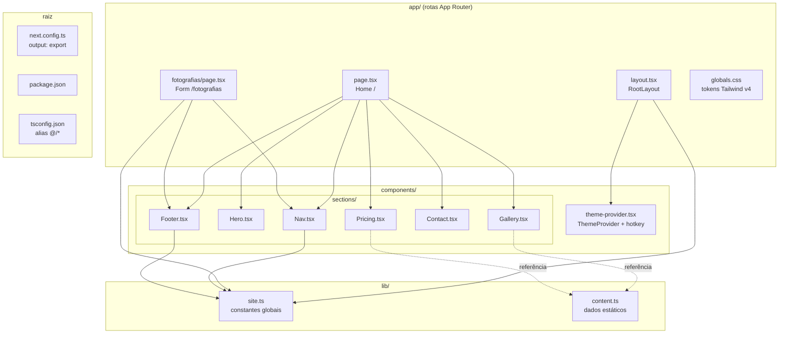
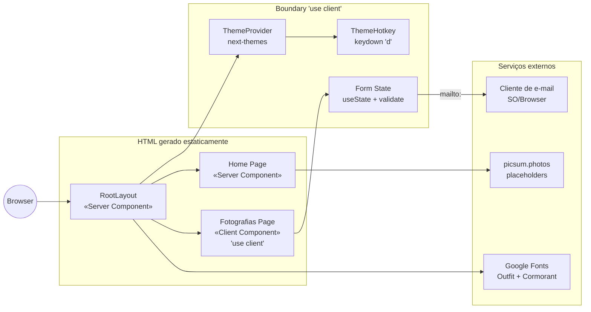
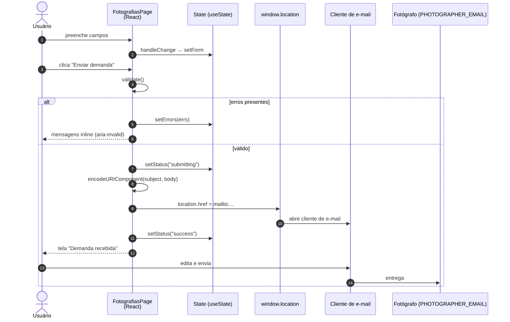
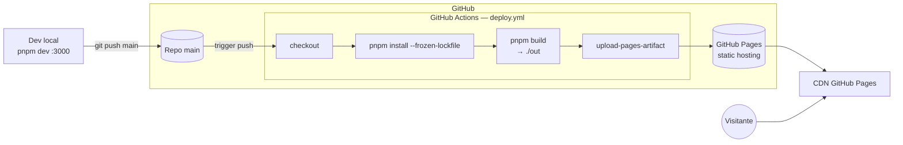

# Documentação de Arquitetura — `multica-website-example`

Portfólio pessoal de fotografia construído com **Next.js 16 (App Router)**, exportado como site estático (`output: "export"`) e publicado no **GitHub Pages**. A rota `/fotografias` (entrega do LEDS-9) adiciona um formulário client-side de captação de demandas que entrega a mensagem via `mailto:`.

> Observação: o `README.md` menciona "Astro" em uma linha — está incorreto. O stack real é Next.js 16 + React 19 + Tailwind v4 + shadcn. Vale corrigir em follow-up.

---

## 1. Visão geral do stack

| Camada | Tecnologia | Papel |
|---|---|---|
| Framework | Next.js 16 (App Router) | Roteamento file-based + SSG |
| UI | React 19 (Server Components default) | Composição |
| Estilo | Tailwind CSS v4 + shadcn | Design system utilitário |
| Tema | `next-themes` | Dark/light via classe + hotkey `d` |
| Build | `next build` com `output: "export"` | Export 100% estático em `./out` |
| Hospedagem | GitHub Pages | Via workflow `.github/workflows/deploy.yml` |
| Form delivery | `mailto:` (sem backend) | Compatível com export estático |
| Package manager | pnpm 12 | `pnpm-workspace.yaml` só para `allowBuilds` |

---

## 2. Diagrama de pacotes (estrutura de módulos)



---

## 3. Diagrama de componentes (UML — runtime)



Pontos-chave:

- **RootLayout** aplica fontes (`next/font/google`) e injeta `ThemeProvider` — único client boundary da home.
- **Home** é 100% Server Component; renderiza seções estáticas.
- **FotografiasPage** declara `"use client"` por depender de `useState`, `useEffect` e `window.location`.
- Sob `output: "export"` não existem Server Actions nem rotas de API — por isso o envio usa `mailto:`.

---

## 4. Diagrama de classes/módulos — página `/fotografias`

```mermaid
classDiagram
  class FotografiasPage {
    -status: FormState
    -errors: FormErrors
    -minDate: string
    -form: FormData
    +handleChange(e) void
    +validate() FormErrors
    +handleSubmit(e) void
  }

  class FormState {
    <<type>>
    idle | submitting | success | error
  }

  class FormData {
    +nome: string
    +email: string
    +tipoEnsaio: string
    +dataDesejada: string
    +local: string
    +descricao: string
  }

  class FormErrors {
    <<type>>
    Partial Record nome|email|tipoEnsaio, string
  }

  class Field {
    <<component>>
    +label: string
    +fieldId?: string
    +required?: boolean
    +error?: string
    +children: ReactNode
  }

  class siteConstants {
    <<module lib/site.ts>>
    +PHOTOGRAPHER_NAME
    +SITE_DESCRIPTION
    +PHOTOGRAPHER_EMAIL
  }

  FotografiasPage --> FormState : status
  FotografiasPage --> FormData : form
  FotografiasPage --> FormErrors : errors
  FotografiasPage --> Field : usa 6x
  FotografiasPage ..> siteConstants : importa PHOTOGRAPHER_EMAIL
  Field --> "p#id-error" : aria-describedby
```

Invariante de acessibilidade: `fieldId` passado em `Field` gera `id={fieldId}-error` para o `<p role="alert">`, fechando o `aria-describedby` do input (fix do review).

---

## 5. Diagrama de sequência — submissão do formulário



Notas:

- `setStatus("submitting")` e `setStatus("success")` acontecem no mesmo tick (nit documentado): o label "Abrindo e-mail…" é inatingível na prática.
- `catch` em volta de `window.location.href = ...` quase nunca dispara (navegação não lança); permanece como fallback simbólico (nit).

---

## 6. Diagrama de deployment



Config relevantes em `next.config.ts`:

- `output: "export"` → gera `./out` com HTML estático.
- `basePath: process.env.NEXT_PUBLIC_BASE_PATH ?? "/multica-website-example"` → prefixo necessário para GitHub Pages de projeto.
- `trailingSlash: true` → URLs com `/` final (ex.: `/fotografias/`), compatível com Pages.
- `images.unoptimized: true` → desliga o otimizador do Next (incompatível com export).

---

## 7. Decisões arquiteturais (ADR curto)

| # | Decisão | Motivação | Trade-off |
|---|---|---|---|
| 1 | `output: "export"` em vez de Node runtime | GitHub Pages = hosting estático; zero custo operacional | Sem Server Actions / API routes |
| 2 | Envio via `mailto:` | Compatível com (1); zero backend | Depende de cliente de e-mail configurado; não há persistência |
| 3 | Server Components por default; `"use client"` só onde há estado | Minimizar JS enviado ao cliente | `/fotografias` carrega bundle React de form |
| 4 | Conteúdo em `lib/content.ts` | Editar sem mexer em JSX | `Gallery.tsx` ainda tem array próprio — oportunidade de refactor |
| 5 | Tailwind v4 + tokens em `globals.css` | Design system coerente dark/light via tokens `oklch` | Lock-in no Tailwind |
| 6 | `next-themes` com hotkey `d` | Toggle rápido sem UI dedicada | Descoberta ruim para end-user (não documentada) |

---

## 8. Boas práticas aplicadas

- ✅ **Separação de responsabilidades**: layout global, seções da home, página de formulário e dados estão em pastas distintas.
- ✅ **Constantes centralizadas** em `lib/site.ts` (nome, descrição, e-mail).
- ✅ **Server/Client boundary explícito**: só `/fotografias` e `theme-provider` são client.
- ✅ **Acessibilidade do formulário**: `aria-invalid`, `aria-describedby` com ID real, `htmlFor`/`id` pareados, `role="alert"` nos erros.
- ✅ **Validação JS explícita** (nome, regex de e-mail, `tipoEnsaio` obrigatório) antes de disparar o fluxo.
- ✅ **Hydration-safe**: `minDate` populado em `useEffect` para não divergir entre build e client.
- ✅ **CI reprodutível**: `pnpm install --frozen-lockfile` + build + upload de artefato.

---

## 9. Dívidas técnicas e follow-ups

| Prioridade | Item | Local |
|---|---|---|
| 🔴 Pré-deploy | Substituir `PHOTOGRAPHER_EMAIL = "hello@example.com"` pelo endereço real | `lib/site.ts:3` (TODO marcado) |
| 🟡 Média | `Gallery.tsx` tem `gallery` próprio, duplicando `lib/content.ts` | `components/sections/Gallery.tsx:27` |
| 🟡 Média | `Contact.tsx` tem `hello@example.com` hard-coded (não usa `PHOTOGRAPHER_EMAIL`) | `components/sections/Contact.tsx:13` |
| 🟡 Média | `<html lang="en">` no layout enquanto `/fotografias` é 100% pt-BR | `app/layout.tsx:38` |
| 🟢 Baixa | README diz "Astro"; stack real é Next.js | `README.md:3` |
| 🟢 Baixa (nit) | Estado `"submitting"` nunca é pintado (navegação síncrona pós-`mailto:`) | `app/fotografias/page.tsx:75-94` |
| 🟢 Baixa (nit) | `catch` em volta de `window.location.href` quase inatingível | `app/fotografias/page.tsx:95-97` |
| ⚠️ Segurança | Alerta "vulnerabilidade conhecida" no log do Next 16.4.0 — reporter optou por não investigar neste ciclo (opção A) | `package.json:17` |

---

## 10. Fluxo de desenvolvimento

```bash
pnpm install        # instala deps (allowBuilds em pnpm-workspace.yaml)
pnpm dev            # http://localhost:3000
pnpm lint
pnpm typecheck      # tsc --noEmit
pnpm build          # gera ./out
pnpm format         # prettier --write
```

Deploy: `git push origin main` → workflow `deploy.yml` publica em GitHub Pages.

---

## Referências

- Issue de origem: LEDS-9 — "Criar página de envio de demandas de fotografia"
- Doc da feature: [`./fotografias.md`](./fotografias.md)
- PR da feature: [#8](https://github.com/paulossjunior/multica-website-example/pull/8) — HEAD `a2ce64f`, merge commit `ac3084e`
